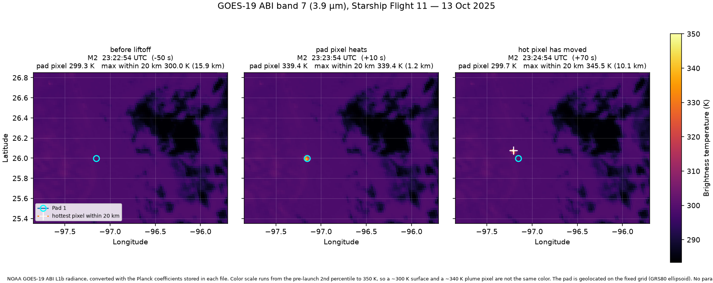

# monitoreAR

monitoreAR is a small, open-source detector for large rocket launches in public GOES satellite imagery. Version 0.1 watches a few fixed sites with GOES-East ABI band 7, the 3.9 µm shortwave infrared band, and publishes what it finds through a simple JSON API and a map.

The project is for learning the real limits of this data. A pixel is a few kilometres wide, a scan can miss a burn that lasts about a minute, clouds and sunlight get into the measurement, and a hot pixel is not a flame temperature. Those limits stay visible in the method and in the output. monitoreAR is not an operational launch service, and it is not trying to match commercial detectors.

The software is free to use. A Cafecito link will sit on the public page once that page exists. There is no paid tier.

## What v0.1 will do

- Watch a short list of pads that GOES-East sees well. The first one is Starbase Pad 1. Atlantic and South American sites, such as the Cape and Kourou, can be added later. Global coverage is out of scope.
- Look for the short, bright thermal pulse of a large launch in ABI band 7.
- Score each watch area with a documented brightness and temporal-anomaly rule, and keep the threshold conservative.
- Store each candidate with its time, pixel location, score, raw values, and the source file.
- Serve recent candidates as JSON, and show them on a single map with the thermal crop that triggered the score.

## What v0.1 will not do

- Detect small launch vehicles. At this resolution they are often invisible.
- Estimate altitude, correct parallax, or draw a trajectory.
- Fuse several satellites, or classify plumes with a machine-learning model.
- Claim a launch when the watch site was not scanned, was under cold cloud, or only looks a little warmer than the surrounding land.
- Send alerts that anyone should treat as operational.

## Where the project is

Milestone 1 is in the repository. It is a historical case study of Starship Flight 11, which lifted off from Starbase at 23:23:45 UTC on 13 October 2025. The script downloads GOES-19 ABI Level 1b band 7 from the public bucket `noaa-goes19`, converts radiance to brightness temperature, and plots the pad on the ABI fixed grid.



On the mesoscale sector that actually contained the pad, the pad pixel sat near 299 K before liftoff, jumped to 339 K on the scan that started 10 seconds after liftoff, and was back near 300 K a minute later. The hottest pixel on that next scan was 346 K and about 10 km from the pad. The background stayed near 298–300 K. Two further scans were only a few kelvin warmer, farther downrange. Nothing in the sector hit the 411 K radiance ceiling. The full table is in [`outputs/m1_inspection.txt`](outputs/m1_inspection.txt).

That one event already fixes several design choices. They are written up in [`ARCHITECTURE.md`](ARCHITECTURE.md).

Milestones 2 through 6 are not built yet: a control-day and fire comparison, the detector, a near-real-time poller, the public API and map, and packaging.

## Reproduce the case study

From the repository root, with Python 3.12:

```bash
python3 -m venv .venv
.venv/bin/pip install -r requirements.txt
.venv/bin/python scripts/m1_starship_flight11.py
```

On Debian or Ubuntu, `python3 -m venv` needs the `python3-venv` package (`python3.12-venv` for this interpreter).

The script reads public objects with anonymous access. It stores NetCDF files under `data/m1/` and does not commit them. A second run reuses files that are already there. It rewrites:

- `outputs/m1_starship_flight11_band7.png`
- `outputs/m1_inspection.txt`

The run needs a network path to Amazon S3. It downloads the 36 mesoscale band-7 files for 23:18–23:36 UTC, about 11 MB.

## Data

GOES-19 ABI data are produced by NOAA and distributed on the NOAA Open Data Registry. This project is not a NOAA service. Each detection, when the pipeline exists, will keep the source object name so the file can be fetched again.

Band 7 Level 1b files store radiance in mW m⁻² sr⁻¹ (cm⁻¹)⁻¹. Brightness temperature in this repository is computed from the Planck coefficients inside the same file. Those coefficients do not remove reflected sunlight. At the Flight 11 liftoff the Sun was still about 8° above the horizon, so the background includes a solar contribution. The 40 K jump in one pixel does not.

## Layout today

```
scripts/m1_starship_flight11.py   historical case study
outputs/                          figure and inspection report
requirements.txt                  libraries used by that script
data/                             downloaded NetCDF, gitignored
ARCHITECTURE.md                   decisions and the path to v0.1
```

## License

The code is meant to be open source. A license file has not been added yet.
