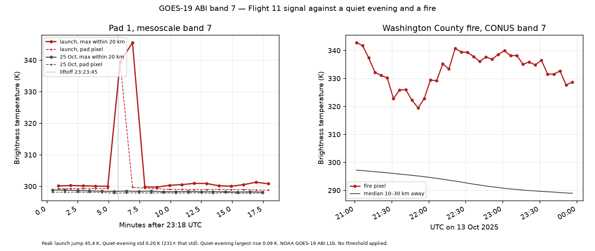

# monitoreAR

monitoreAR is a small, open-source detector for large rocket launches in public GOES satellite imagery. Version 0.1 watches a few fixed sites with GOES-East ABI band 7, the 3.9 µm shortwave infrared band, and publishes what it finds through a simple JSON API and a map.

The project is for learning the real limits of this data. A pixel is a few kilometres wide, a scan can miss a burn that lasts about a minute, clouds and sunlight get into the measurement, and a hot pixel is not a flame temperature. Those limits stay visible in the method and in the output. monitoreAR is not an operational launch service, and it is not trying to match commercial detectors.

The software is free to use. The page carries a Cafecito link as a placeholder. The project page on Cafecito is not set up yet. There is no paid tier.

## What v0.1 will do

- Watch a short list of pads that GOES-East sees well. The first one is Starbase Pad 1. Atlantic and South American sites, such as the Cape and Kourou, can be added later. Global coverage is out of scope.
- Look for the short, bright thermal pulse of a large launch in ABI band 7.
- Score each watch area with a documented brightness and temporal-anomaly rule, and keep the threshold conservative.
- Store each candidate with its time, pixel location, score, raw values, and the source file.
- Serve recent candidates as JSON, and show them on a single map with the thermal crop that triggered the score.

## What v0.1 will not do

- Detect small launch vehicles. At this resolution they are often invisible.
- Estimate altitude, correct parallax, or draw a trajectory.
- Fuse several satellites, or classify plumes with a machine-learning model.
- Claim a launch when the watch site was not scanned, was under cold cloud, or only looks a little warmer than the surrounding land.
- Send alerts that anyone should treat as operational.

## Where the project is

Milestone 1 is in the repository. It is a historical case study of Starship Flight 11, which lifted off from Starbase at 23:23:45 UTC on 13 October 2025. The script downloads GOES-19 ABI Level 1b band 7 from the public bucket `noaa-goes19`, converts radiance to brightness temperature, and plots the pad on the ABI fixed grid.


On the mesoscale sector that actually contained the pad, the pad pixel sat near 299 K before liftoff, jumped to 339 K on the scan that started 10 seconds after liftoff, and was back near 300 K a minute later. The hottest pixel on that next scan was 346 K and about 10 km from the pad. The background stayed near 298–300 K. Two further scans were only a few kelvin warmer, farther downrange. Nothing in the sector hit the 411 K radiance ceiling. The full table is in [`outputs/m1_inspection.txt`](outputs/m1_inspection.txt).

Milestone 2 is also in the repository. It measures that pulse against a quiet mesoscale evening and against a fire, and it does not choose a detection threshold.



The 20 km maximum jumped 45.4 K above the pre-liftoff median, on two scans, and then returned to about 300 K. On 25 October, the nearest evening when a mesoscale sector contained the pad at the same clock time, that maximum has a standard deviation of 0.20 K. A fire pixel in Washington County, Georgia, the same evening stayed about 43 K above the surrounding land for at least 175 minutes, with a peak band-7 brightness temperature near 340 K. The full table is in [`outputs/m2_signal.txt`](outputs/m2_signal.txt). The walkthrough is in [`docs/signal-comparison.md`](docs/signal-comparison.md).

Milestone 3 scores that comparison. The watch list is Pad 1. The score is the hottest pixel within 20 km minus the median of that maximum on the previous mesoscale scans. The frozen threshold is 20 K. Flight 11 produces two candidates, 39.29 K at 23:23:54.9 UTC and 45.37 K at 23:24:54.9 UTC. The quiet evening's largest score is 0.04 K. An already-burning fire, scored with the same rule, peaks at 12.36 K and produces none. Candidates are logged with coordinates, the score, and the raw values in [`outputs/m3_candidates.jsonl`](outputs/m3_candidates.jsonl). The walkthrough is in [`docs/scoring.md`](docs/scoring.md).

That case study fixes the design choices written up in [`ARCHITECTURE.md`](ARCHITECTURE.md). The equations — the file path, the Planck conversion, the fixed grid, the viewing angles, how the figure is chosen, how the comparison is scored, how the threshold is applied, and how a scan is stored — are in [`docs/`](docs/README.md).

Milestone 4 is the poller. `scripts/m4_poll.py` replays the Flight 11 hour into SQLite, then takes two live passes a minute apart over the current and previous hour of mesoscale band 7. The score is the Milestone 3 rule, and the same object key is stored once. A sector that misses Pad 1 is stored as a coverage gap. On 23 November 2026, hours 21 and 22 UTC, neither mesoscale sector contained the pad, so the live passes stored no candidate. The only emitted rows are still the two Flight 11 scans, 39.29 K and 45.37 K. The run log is [`outputs/m4_poll.txt`](outputs/m4_poll.txt). The walkthrough is [`docs/polling.md`](docs/polling.md).

Milestone 5 is the page. `scripts/m5_api.py` reads the SQLite rows and serves them at `http://127.0.0.1:8000/`. `GET /detections` is the candidates, including the score, the raw temperatures, and the source file. The map draws the hot pixel of each candidate and the pad. The thermal crop is a PNG in [`outputs/crops/`](outputs/crops/). On this database the two emitted points are still Flight 11, 39.29 K and 45.37 K, and the newest stored scan is a coverage gap: 23 November 2026, 22:40:54.9 UTC, sector M2, the sector missed the pad. The walkthrough is [`docs/api.md`](docs/api.md).

Milestone 6 is not built yet: notebooks and packaging.

## Reproduce the case study

From the repository root, with Python 3.12:

```bash
python3 -m venv .venv
.venv/bin/pip install -r requirements.txt
.venv/bin/python scripts/m1_starship_flight11.py
.venv/bin/python scripts/m2_signal.py
.venv/bin/python scripts/m3_score.py
.venv/bin/python scripts/m4_poll.py
.venv/bin/python scripts/m5_api.py
```

`scripts/m5_api.py` listens on http://127.0.0.1:8000/ until interrupted. It needs the database from the poller.

On Debian or Ubuntu, `python3 -m venv` needs the `python3-venv` package (`python3.12-venv` for this interpreter).

The scripts read public objects with anonymous access. They store NetCDF files under `data/` and do not commit them. A second run reuses files that are already there. Milestone 1 rewrites:

- `outputs/m1_starship_flight11_band7.png`
- `outputs/m1_inspection.txt`

Milestone 2 reuses `data/m1/` and rewrites:

- `outputs/m2_signal.png`
- `outputs/m2_signal.txt`

Milestone 3 reuses those files and rewrites:

- `outputs/m3_score.txt`
- `outputs/m3_candidates.jsonl`

Milestone 4 reuses files already on disk and rewrites:

- `outputs/m4_poll.txt`

It also writes `data/m4/monitorear.sqlite`. A second run leaves stored keys in place and only inserts files the bucket has added.

Milestone 5 reads that database and rewrites:

- `outputs/m5_api.txt`
- `outputs/crops/*.png` for each candidate that does not already have one

The run needs a network path to Amazon S3. Milestone 1 downloads the 36 mesoscale band-7 files for 23:18–23:36 UTC, about 11 MB. Milestone 2 adds the quiet-evening mesoscale window and three hours of CONUS band 7, about 139 MB, under `data/m2/`. Milestone 4 adds the rest of Flight 11 hour 23 and the live mesoscale files it opened, about 87 MB under `data/m4/cache/`, plus the SQLite file (about 188 KB). All of `data/` stays gitignored.

## Data

GOES-19 ABI data are produced by NOAA and distributed on the NOAA Open Data Registry. This project is not a NOAA service. Each detection keeps the source object name so the file can be fetched again.

Band 7 Level 1b files store radiance in mW m⁻² sr⁻¹ (cm⁻¹)⁻¹. Brightness temperature in this repository is computed from the Planck coefficients inside the same file. Those coefficients do not remove reflected sunlight. At the Flight 11 liftoff the Sun was still about 8° above the horizon, so the background includes a solar contribution. The 40 K jump in one pixel does not.

## Layout today

```
scripts/m1_starship_flight11.py   Flight 11 scene
scripts/m2_signal.py              quiet evening and fire comparison
scripts/m3_score.py               watch-site score and candidate log
scripts/m4_poll.py                one-minute poller and the SQLite store
scripts/m5_api.py                 JSON API and the map page
scripts/m5_map.html               the page the API serves
docs/                             equations and the walkthroughs
outputs/                          figures, reports, crops, and the candidate log
requirements.txt                  libraries used by those scripts
data/                             downloaded NetCDF, gitignored
ARCHITECTURE.md                   decisions and the path to v0.1
```

## License

The code is meant to be open source. A license file has not been added yet.
