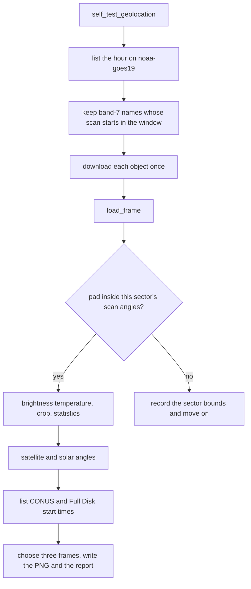

# From the bucket to one frame

[`scripts/m1_starship_flight11.py`](../scripts/m1_starship_flight11.py) has one entry point. `main()` runs when the file is executed. There are no command-line arguments. The event, the pad, the map window, and the bucket are constants at the top of the file.

| Constant | Value | Role |
| --- | --- | --- |
| `LIFTOFF` | 2025-10-13 23:23:45 UTC | Quoted liftoff (NASASpaceflight.com, 6:23:45 pm CDT). The ABI clock is separate. |
| `PAD_LAT`, `PAD_LON` | 25.9962°N, 97.1544°W | Orbital Launch Pad 1. Launch Library 2, consistent with Wikidata 25°59'46.2"N, 97°9'16.0"W to about 10 m. |
| `CROP_LAT`, `CROP_LON` | 25.35–26.85°N, 97.85–95.70°W | Map window around the pad and the first minutes over the Gulf. |
| `BUCKET` | `noaa-goes19` | Public NOAA Open Data bucket. GOES-19 is the operational GOES-East spacecraft for this date. |
| `PREFIX` | `noaa-goes19/ABI-L1b-RadM/2025/286/23/` | Mesoscale Level 1b radiance, day 286 of 2025 (13 October), hour 23 UTC. |
| `WINDOW_START`, `WINDOW_END` | 23:18–23:36 UTC | Scan-start times kept from that hour. |

`ROOT` is the repository directory, two levels above the script. Downloads go to `data/m1/` (gitignored). The figure and the text report go to `outputs/`.

## What `main` does



The geolocation self-test runs before any network call. It is described in [Fixed-grid geometry](fixed-grid-geometry.md).

The S3 client is anonymous and pinned to `us-east-1`:

```python
fs = s3fs.S3FileSystem(anon=True, client_kwargs={"region_name": "us-east-1"})
```

`list_band7_keys` lists `PREFIX` and keeps names that contain `C07_G19_` and whose scan start falls inside the window. The script lists real object names. It does not invent timestamps.

`download` writes `data/m1/<filename>`. A later run skips a file that is already there and non-empty.

## The filename

A real object from this window, the scan in which the pad pixel heats:

```
OR_ABI-L1b-RadM2-M6C07_G19_s20252862323549_e20252862324019_c20252862324058.nc
```

`parse_abi_name` splits that on `_`:

| Piece | Meaning in this file |
| --- | --- |
| `OR` | Operational system environment. The file attribute `production_environment` is `OE`. |
| `ABI-L1b-RadM2` | Level 1b radiance, mesoscale sector 2. Sector 1 is `RadM1`. |
| `M6` | ABI Mode 6. The file attribute `timeline_id` is `ABI Mode 6`. |
| `C07` | Channel 7, band 7. |
| `G19` | GOES-19. File attributes: `platform_ID` G19, `orbital_slot` GOES-East, `instrument_ID` FM4. |
| `s20252862323549` | Scan start. |
| `e20252862324019` | Scan end. |
| `c20252862324058` | Ground-system product creation. |

`parse_goes_time` reads `YYYYDDDHHMMSSt`. The last digit is tenths of a second. `s20252862323549` is year 2025, day-of-year 286, 23:23:54.9 UTC. In this window every pad-seeing scan lasts 6.9–7.1 s, so the matching end stamp is 23:24:01.9 UTC and the creation stamp is 23:24:05.8 UTC.

The creation stamp is the ground-system product time. This milestone measures creation minus scan end: minimum 3.4 s, median 3.8 s, maximum 4.6 s on the frames that contain the pad. The moment the object appeared in the public bucket is a different clock, and these archive files do not record it.

The global `license` attribute still says unclassified data with access restricted to approved users. The objects used here were read from the public NOAA Open Data bucket. The producer is NOAA, site WCDAS, `production_data_source` Realtime.

## Two mesoscale sectors

Mode 6 scans two mesoscale sectors. Each sector in this hour is a 500×500 array of band-7 pixels. The filename says which sector, and the scan angles say where it was pointed. `load_frame` projects the pad into scan angles (see [Fixed-grid geometry](fixed-grid-geometry.md)) and keeps the frame when the pad's `(x, y)` sits inside the min/max of that file's `x` and `y` coordinates.

In the 23:18–23:36 window the script listed 36 band-7 mesoscale files. Eighteen contain the pad. All eighteen are sector M2, and the gap between their scan starts is 60.0 s on every step.

The other eighteen are sector M1. They are pointed at the tropical Atlantic. One example, the 23:18:24.9 M1 file, has its centre at 14.42°N, 40.98°W, with bounds 9.49–19.70°N and 47.60–32.50°W. Those files are opened far enough to read that extent, and they contribute no crop and no brightness temperatures.

A 30-second revisit would require both sectors to contain the pad. In this hour they do not, so the pad is seen once a minute.

## CONUS and Full Disk, listed only

`list_other_sector_times` lists the same hour of `ABI-L1b-RadC` (CONUS) and `ABI-L1b-RadF` (Full Disk), keeps `C07_G19_` names inside the window, and records scan-start times. Those files are not downloaded and not opened.

| Product | Band-7 scan starts in the window |
| --- | --- |
| CONUS | 23:21:17, 23:26:17, 23:31:17 |
| Full Disk | 23:20:20, 23:30:20 |

The two mesoscale scans that actually heat up start at 23:23:54.9 and 23:24:54.9. None of those CONUS or Full Disk start times fall on those two minutes.

## What one opened frame stores

For a frame that contains the pad, `load_frame` keeps:

- the Planck coefficients, band id, wavelength, and radiance units
- `esun`, `kappa0`, the file-level `saturated_pixel_count`, and `yaw_flip_flag`
- the fixed-grid projection constants and the nominal subsatellite point
- brightness temperature for the whole array, then the crop inside `CROP_LAT` / `CROP_LON`
- the pad pixel, the hottest pixel within 20 km, and the hottest pixel in the crop
- DQF counts inside the crop

The conversions themselves are the next three notes. The rule that picks the three plotted frames is in [How the figure and the report are chosen](figure-and-report.md).
